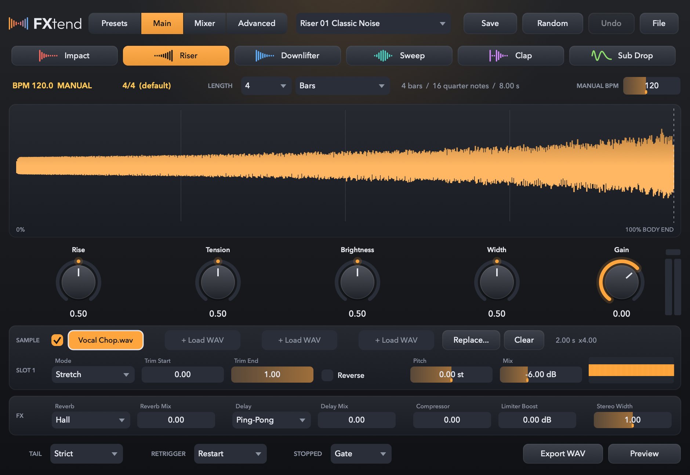

# FXtend

効果音専用のプラグイン音源です。Impact、Riser、Downlifter、Sweep、Clap、Sub Drop といった、曲の展開をつなぐ音を鳴らします。

長さを「4 小節」のように決めて MIDI ノートを 1 個置けば、曲のテンポに合わせて、狙った位置でぴたりと鳴り終わります。

- **長さは小節と拍で決めます。** ノートを置いた位置から、決めた長さできっちり鳴り終わります。ノートの長さは関係ありません。
- **サンプルがなくても鳴ります。** 音はすべて内蔵のシンセ（Noise / Sub / FM / Transient / Clap）で作っていて、61 種類の Factory プリセットがすぐに使えます。
- **手持ちのサンプルも重ねられます。** WAV / AIFF を 4 つまで読み込み、Stretch、Resample、Loop、One-shot から鳴らし方を選べます。



音を聞きたい方、画面をもっと見たい方は [紹介ページ](https://cheebow.github.io/FXtend/)（[English](https://cheebow.github.io/FXtend/en/)）をどうぞ。

## インストール

[最新のリリース](https://github.com/cheebow/FXtend/releases/latest) からインストーラ（`.pkg`）をダウンロードして開き、画面の案内に沿って進めてください。VST3、Audio Unit、スタンドアロンアプリの中から、入れたいものを選べます。

- macOS 12 以降
- Apple Silicon。Intel Mac でも動くように作っていますが、実機ではまだ試せていません。

### アンインストール

次のものを削除します。自分で保存したプリセットと読み込んだサンプルも消すなら、最後の 1 つも削除してください。

```text
/Library/Audio/Plug-Ins/VST3/FXtend.vst3
/Library/Audio/Plug-Ins/Components/FXtend.component
/Applications/FXtend.app
~/Library/Application Support/FXtend
```

## 使い方

1. インストゥルメントトラックに FXtend を立ち上げて、プリセットか FX タイプを選びます。
2. `LENGTH` で長さを決めます（たとえば 4 Bars）。それが何拍ぶんで何秒になるかは、すぐ横に表示されます。
3. 鳴らしたい位置に MIDI ノートを 1 個置きます。ノートの高さや長さは音に関係ありません。音量はベロシティで変わります。
4. `TAIL` で終わり方を選びます。`Strict` ならすぱっと無音に、`Natural` ならリバーブやディレイの余韻だけが残ります。
5. もっと作り込みたくなったら `Advanced` を開くと、レイヤーごとの設定と Master を編集できます。`Export WAV` を押せば、いまのテンポと長さのままファイルに書き出せます。

スタンドアロンアプリのように DAW からテンポが届かないときは、`MANUAL BPM` の値で鳴らします。そのあいだ、テンポの表示は `MANUAL` になります。

## データの保存場所

| 内容 | 場所 |
|---|---|
| 自分で保存したプリセット（`.fxpreset`、中身は JSON） | `~/Library/Application Support/FXtend/Presets` |
| 読み込んだサンプルのコピー | `~/Library/Application Support/FXtend/Samples` |

サンプルは、読み込んだときに上のフォルダへコピーされます。プロジェクトやプリセットにはそのコピーへの参照だけが保存されるので、元のファイルを動かしても、同じ Mac なら変わらず鳴ります。

別の Mac に持っていくときは、`File > Export Preset Package...` でプリセットとサンプルをひとつのファイル（`.fxtendpack`）にまとめてください。

読み込むサンプルは、利用条件を確かめたうえでお使いください。

## まだできないこと・知っておいてほしいこと

- **動作を確認した DAW**: Cubase、Fender Studio、Logic Pro。`auval` と pluginval（strictness 10）も、VST3・AU とも通っています。
- **Windows** には対応していません。
- **ノートの高さ**で音程やプリセットを変えることはできません。
- **DAW へ WAV を直接ドラッグ**することはできません。`Export WAV` でファイルに書き出してください。
- **再生中にテンポが変わったときの Stretch**: テンポが一定のあいだは、音程を保ったまま伸縮した音を鳴らします。途中でテンポが変わると、終わる位置を合わせることを優先して再生速度を変えるので、そのあいだは音程もテンポの変化ぶんだけずれます。
- **Overlap と Strict を一緒に使うとき**: リバーブとディレイは全体で 1 つなので、最後に鳴っている音が終わる位置でまとめて無音になります。
- **Custom 4-point カーブ**は、エンジンとプリセットは対応していますが、編集する画面がまだありません。

---

ここから下は、ソースコードを触る方向けです。

## ビルド

Xcode と CMake 3.24 以降が必要です。JUCE 9、Rubber Band、Catch2 は、最初の `cmake` のときに自動でダウンロードされます。

```sh
cmake -B build -G Xcode
cmake --build build --config Release
ctest --test-dir build -C Release --output-on-failure
```

ビルドが終わると、プラグインは `~/Library/Audio/Plug-Ins` の `VST3` と `Components` にコピーされます。コピーしたくないときは `-DFXTEND_COPY_PLUGIN_AFTER_BUILD=OFF` を付けてください。スタンドアロンアプリは `build/FXtend_artefacts/Release/Standalone/` にできます。

## インストーラを作る

```sh
scripts/package-macos.sh
```

Apple Silicon と Intel の両方で動く形でビルドし、VST3、AU、スタンドアロンアプリを入れるインストーラを `build-dist/package/` に作ります。インストール先は `/Library/Audio/Plug-Ins/VST3`、`/Library/Audio/Plug-Ins/Components`、`/Applications` です。

ほかの Mac で開けるようにするには、署名と Apple の公証が必要です。次の環境変数で指定します。指定しなければ、署名なしのインストーラができます。

| 環境変数 | 内容 |
|---|---|
| `SIGN_APP` | `Developer ID Application: 名前 (チームID)`。プラグインとアプリの署名に使います |
| `SIGN_PKG` | `Developer ID Installer: 名前 (チームID)`。インストーラの署名に使います |
| `NOTARY_PROFILE` | `xcrun notarytool store-credentials` で作ったプロファイルの名前。指定すると Apple の公証に出し、通ったらチケットを付けます |

## ソースコードの構成

```text
src/engine/   音を鳴らすエンジン。DAW や画面には依存しません
                TransportClock  DAW から届く位置（PPQ）・BPM・拍子を、処理ブロックごとの時間軸にします
                FxVoice         1 回ぶんの発音。進み具合 = (PPQ - 開始PPQ) / 長さ。終わる位置のサンプルで止まります
                SynthLayer / SampleLayer / MasterFx / FxTemplates（FX タイプとノブ）
                OfflineRenderer / WavExport
src/dsp/      ノイズ、フィルター、オシレーター、カーブ、タイムストレッチ（Rubber Band）
src/sample/   サンプルの読み込みと、コピーの管理
src/preset/   プリセットの JSON 形式、Factory プリセット、自分で保存したプリセット、パッケージ
src/ui/       画面の部品
src/          プラグインとしての外側（AudioProcessor / Editor / DAW に見せるパラメータ）
tests/        DAW の代わりをする仕組みで、エンジンとプラグインを動かす自動テスト
```

レイヤーと Master の設定項目は、`src/engine/LayerFields.cpp` にある表 1 か所で決めています。DAW に見せるパラメータも、プリセットも、編集画面も、この表から作られます。

**表の id と選択肢の並び順は、保存済みのデータと結びついています。項目を足すときは必ず末尾に足し、すでにあるものは変えないでください。**

仕様は [`FXtend_SPEC.md`](FXtend_SPEC.md)、テストの計画と DAW での確認手順は [`docs/TEST_PLAN.md`](docs/TEST_PLAN.md) にあります。仕様と実装が違うところは、上の「まだできないこと・知っておいてほしいこと」にまとめています。

## ロゴとアイコン

`assets/logo/` に入っています。

- **マーク**: 消えていく音と立ち上がる音が向かい合って、X の形になる絵です。
- **ロゴ**: 暗い背景用と明るい背景用があります。
- **アプリのアイコン**

元のデータは SVG で、PNG はそこから書き出したものです。ロゴの文字は [Outfit](https://github.com/Outfitio/Outfit-Fonts)（SIL Open Font License 1.1）を図形に変えてあるので、フォントが入っていない環境でも同じ形で表示されます。プラグインの画面左上のロゴも、同じ図形を描いています。

## ライセンス

Copyright © 2026 CHEEBOW

FXtend は、GNU Affero General Public License v3.0（[`LICENSE`](LICENSE)）で公開しているフリーソフトウェアです。

- [JUCE](https://juce.com) 9 を、AGPLv3 の条件で使っています。
- [Rubber Band Library](https://breakfastquay.com/rubberband/) を、GPL（v2 以降）の条件で使っています。

どちらもビルドのときにダウンロードされるもので、このリポジトリには入っていません。インストーラに入れている表記は [`THIRD_PARTY_NOTICES.md`](THIRD_PARTY_NOTICES.md) にあります。

「FXtend」という名前について、正式な商標調査はしていません。ウェブ検索で、同じ名前の音楽ソフトが見つからないことを確かめただけです。
